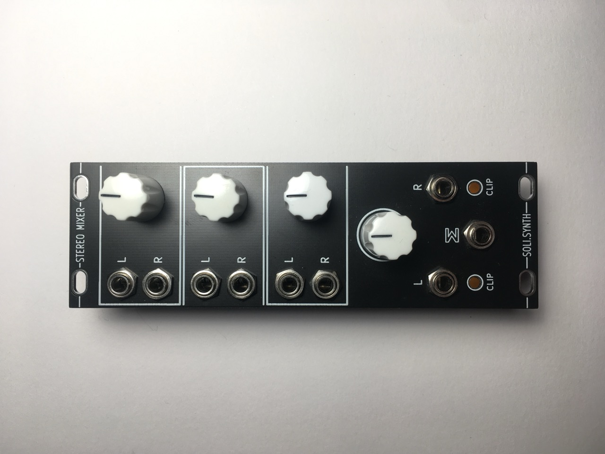

# STEREO MIXER #

### Compact Three-Channel Stereo Mixer ###

  

STEREO MIXER is a stereo line mixer in 8 HP for the end of your signal chain. It mixes three stereo inputs into a stereo output, with a dual-gang level knob per channel and a master level knob, so left and right always move together.

Each right input is normalled to its left input: patch a mono signal into L and it is sent to both sides. Two clip LEDs show when the left or right mix gets too hot. A third output carries a mono sum of the mix.

## Get one
STEREO MIXER is available from [Solisynth](https://solisynth.com/).

## Features
- 3 stereo inputs, right normalled to left for mono sources
- Dual-gang level knob per channel
- Stereo master level
- Stereo output (L/R) and mono output
- Clip LEDs for left and right

## Specifications
| | |
|---|---|
| Width | 8 HP |
| Depth | TBD |
| Power +12 V | TBD |
| Power −12 V | TBD |

## Hardware
The schematics and PCB layouts are KiCad projects:

- `stereo-mixer-main-pcb/`: main PCB
- `stereo-mixer-frontpanel-pcb/`: front panel

The bill of materials is in [`stereo-mixer-main-pcb/bom/StereoMixer_BOM.csv`](stereo-mixer-main-pcb/bom/StereoMixer_BOM.csv). Gerbers can be generated from the KiCad projects.

## Repository structure
| Folder | Contents |
|---|---|
| `stereo-mixer-main-pcb/` | KiCad project for the main PCB, BOM |
| `stereo-mixer-frontpanel-pcb/` | KiCad project for the front panel |
| `pictures/` | Photos of the module |

## License
STEREO MIXER is open source:

- Hardware: [CERN-OHL-S-2.0](LICENSES/CERN-OHL-S-2.0.txt)
- Documentation: [CC-BY-SA-4.0](LICENSES/CC-BY-SA-4.0.txt)

If you share a modified version or hardware built from these files, it has to stay open source under the same license.
"Solisynth", "STEREO MIXER" and the Solisynth logo are not covered by these licenses: derivatives must use their own name and branding. See [LICENSE.md](LICENSE.md) for details.
